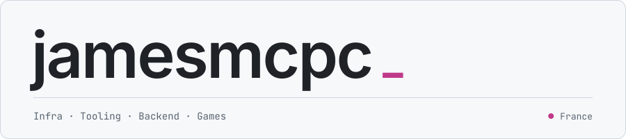

<picture>
  <source media="(prefers-color-scheme: dark)" srcset="assets/banner-dark.svg">
  
</picture>

Hi, I'm James! I started out hosting game servers for my friends, and ended up building my own.
These days, I spend my time working on infrastructure, developer tooling, and games.
Most of that is private, so the changelog below tells the story instead!

##  Changelog

#### [Unreleased]
- **Homelab**   
  My home servers, declared in Nix.
- **Personal infrastructure**    
  The services and tooling I run for myself.

#### [2025]

- **Civilisation event** 
  Worked on a high scale minecraft civilisation event in France (1000 players). [Watch it on YouTube](https://www.youtube.com/watch?v=bBTFzX0b8wE).
- **Quarkus service framework**   
  A Kotlin layer on top of Quarkus: commands, menus and endpoints are declared with annotations.
- **Terraform, pyinfra and GitOps**   
  The whole network provisioned with Terraform, configured with pyinfra and deployed from a GitOps repository.
- **Gradle conventions**   
  Gradle plugins that standardize builds across every project. (To make gradle less insane)
- **Ding**  
  A bot system for testing game servers.

#### [2024]

- **Continuum**    
  A microservice framework, with Kotlin and Go implementations sharing one set of RPC definitions.
- **Rassilon**    
  Handles matchmaking and orchestrates game servers, starting and stopping them on demand.
- **Accounts**   
  The account service shared by every game server, with its RPC definitions and a Go client library.
- **Configs service**  
  Serves and manages the configuration files for every server.
- **Doktor**   
  A CLI for building, packaging and deploying game server containers, with server configs written in Pkl.
- **Game API**  
  A framework and project template for building mini-games.
- **13 mini-games**  
  WarpStar, Racer, Bodyguard, GetRekt and many more, all built on the Game API.

##  Contact

Email: [james@mcpc.dev](mailto:james@mcpc.dev) | Discord: `@jamesmcpc`

Spot the references to Doctor Who in my project names :)